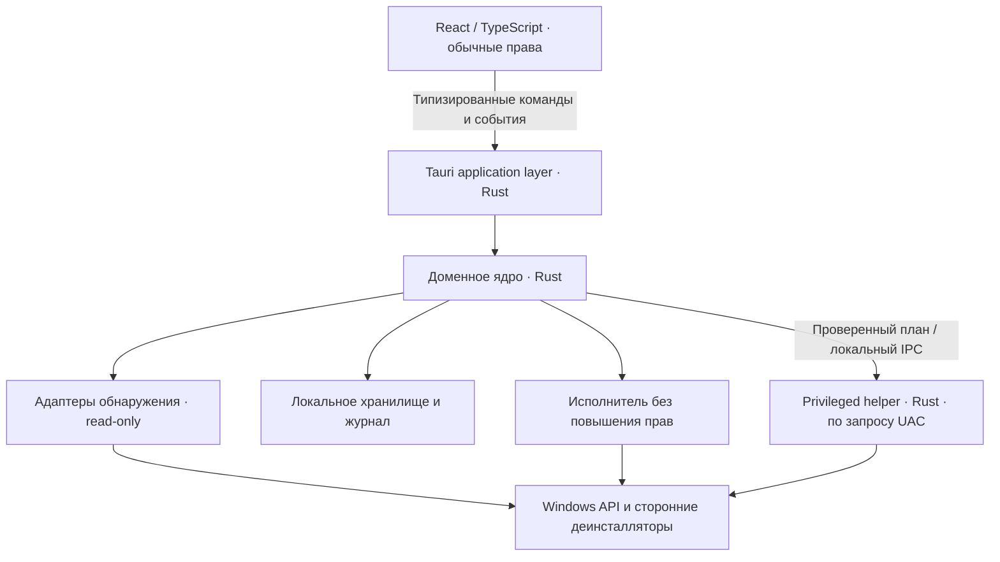

# Архитектура

Статус: целевая архитектура; собственный код ещё не создан, upstream BCU подключён
в `third_party/bcu` для переноса. Разделение модулей проверяется
в M0–M2. Изменения границ доверия, IPC и хранения оформляются отдельными ADR.

## Компоненты



UI имеет доступ к узким командам приложения. Универсальные shell и filesystem
полномочия в WebView не выдаются. Данные от UI, из реестра и сторонних источников
недоверенные; backend проверяет их независимо от валидации интерфейса.
Привилегированный helper не содержит WebView и не обслуживает произвольные запросы.

## Предлагаемая структура кода

```text
apps/desktop/                # React, ресурсы локализации, UI-проверки
apps/desktop/src-tauri/      # Tauri host и application layer
crates/domain/              # Модели, capabilities, ошибки, чистые правила
crates/inventory/           # Провайдеры и объединение результатов
crates/uninstall/           # Планирование, адаптеры, очередь
crates/cleanup/             # Поиск кандидатов, доказательства, резервирование
crates/windows-adapter/     # Узкие обёртки Windows API / COM / WinRT
crates/storage/             # Хранилище, миграции, журнал
crates/privileged-helper/   # Минимальный исполняемый файл с IPC
crates/cli/                 # Поздний клиент того же application/core API
tests/fixtures/             # Синтетические данные
tests/scenarios/            # VM-сценарии и ожидаемые результаты
docs/                       # Спецификации и ADR
third_party/bcu/             # Pinned upstream submodule, отдельно от нашей сборки
```

Это план каталогов, не существующий workspace. В M0 создаются только необходимые
пакеты; пустые crates ради схемы не добавляются. Доменный код не зависит от React,
Tauri и хранения. Провайдеры работают через явные interfaces/traits; зависимости
на конкретные Windows bindings сосредоточены в адаптере.

## Основа BCU

Повторно использовать исходники, правила совместимости и проверочные примеры BCU
по [карте переноса](upstream-reuse.md). Подходящие Apache-файлы переводятся в Rust
с сохранением provenance; перенос считается адаптацией, а не новым авторством
всего алгоритма. Спорные и опасные эвристики проходят наши safety-критерии.

Прямое подключение `UninstallTools.dll` сейчас не принято: библиотека зависит от
ObjectListView и Windows Forms, а каталог ObjectListView содержит GPL-3.0-or-later.
Временный .NET bridge возможен только отдельным ADR с анализом зависимостей,
лицензий и границы прав. CLI upstream можно применять для сравнительного анализа
в VM; запуск его удаления не заменяет проверяемое исполнение нашего плана.

## Основные модели

| Модель | Обязательные сведения |
| --- | --- |
| ApplicationRecord | Внутренний ID, native IDs, название, версия, издатель, source records, scope/SID, архитектура, признаки защиты, capabilities |
| SourceRecord | Provider ID, native key/package ID/product code, projection, исходные поля, время наблюдения и ошибки |
| SizeEstimate | Значение или unknown, метод оценки, shared/partial flags и время измерения |
| UninstallCapability | Режимы, adapter ID/version, требования прав, ограничения и причины недоступности |
| OperationPlan | Schema version, plan ID/digest, creator session, target IDs, scope, режимы, evidence fingerprints, шаги и срок актуальности |
| OperationRecord | Operation ID, plan digest, state, времена, adapter, process identity, exit code, ошибки и результат повторного обнаружения |
| CleanupCandidate | ID программы, тип/путь объекта, identity/fingerprint, доказательства, confidence level, shared/data flags, ограничения |
| BackupRecord | Object ID, источник, backup location, схема, scope, типы/метаданные, checksum, размер, статус и возможные ошибки |

Название не является идентификатором. GUID MSI, package identity, Steam app ID,
ключ реестра с scope/projection и прочие native IDs сохраняются вместе с provenance.
Смена команды или существенной идентичности источника инвалидирует план.

Уровни уверенности очистки: `unknown`, `questionable`, `strong`, `explicit`.
Это объяснимая классификация доказательств, а не вероятность. Даже `explicit`
не отменяет запрет на общие, системные и пользовательские данные.

## Поток инвентаризации

1. Провайдеры читают доступные источники с обычными правами.
2. Нормализация сохраняет raw provenance и unknown-поля.
3. Объединение по сильным идентификаторам; спорные совпадения остаются отдельными.
4. Первый полезный список передаётся UI; дорогие сведения приходят обновлениями.
5. Итог содержит записи, ошибки провайдеров, время и признак полноты.
6. Кэш ускоряет отображение, но команда удаления проверяется по свежему источнику.

Дорогой подсчёт размера и скан каталогов имеют cancellation token, предел числа
задач и ограничение областей. Отмена не означает, что все источники успели завершиться.

## План и исполнение

1. UI передаёт выбранные application IDs и предпочтения режима.
2. Backend перечитывает источники, определяет adapter и формирует неизменяемый план.
3. UI показывает план; пользователь подтверждает его конкретную версию.
4. Backend сравнивает digest, свежесть и идентичность targets; любое существенное
   отличие возвращает план на просмотр.
5. Непривилегированные шаги выполняются в исходном пользовательском контексте.
   Для административных шагов запускается минимальный helper через UAC.
6. Helper независимо проверяет scope, caller, target, adapter и preconditions;
   клиентский plan digest сам по себе не является авторизацией.
7. События прогресса записываются в журнал и доставляются UI. Итог проверяется повторным обнаружением.

Список импортированных команд не исполняется. Импорт задаёт желаемые targets и
настройки; команды восстанавливаются через текущие провайдеры и адаптеры.
Поддерживаемый EXE всё равно является сторонним кодом: собственный журнал не
контролирует все его действия и не обеспечивает транзакционный откат.

## Состояния операции

```text
planned -> awaiting_confirmation -> queued
queued -> validating -> awaiting_elevation -> running -> verifying
                    -> running -> verifying
verifying -> succeeded | succeeded_reboot_required | failed | indeterminate
queued -> skipped | cancelled
validating -> failed | plan_stale
awaiting_elevation -> elevation_denied | running | failed
running -> cancellation_requested -> verifying | indeterminate
running -> interrupted (после сбоя / потери связи)
```

Терминальные состояния сохраняют причины и evidence. `succeeded` используется
только при согласованном результате адаптера и проверке отсутствия target.
Успешный exit code без подтверждения даёт `indeterminate` с пояснением.
Успех с требованием reboot может быть предварительным до повторной проверки после reboot.
Код MSI 1641 фиксируется также как уже инициированная перезагрузка.

Пауза — состояние очереди, а не остановка чужого процесса. Отмена очереди отменяет
ещё не начатые элементы. Отмена текущего удаления только запрашивает поддерживаемое
адаптером действие; принудительное завершение не является обычным cancel.
При reboot-required продолжение очереди определяется политикой адаптера и зависимостей;
по умолчанию потенциально зависимые следующие операции приостанавливаются.

## IPC и повышение прав

Базовый транспорт — локальный named pipe; окончательный протокол и анализ угроз
принимаются отдельным ADR в M2 до реализации helper. Требования:

- ACL ограничивает доступ ожидаемым пользователем/session; отклонять remote clients.
- Стороны проверяют ожидаемую идентичность процессов, токенов и времени создания;
  учтён запуск через UAC с credentials другого администратора.
- Одноразовая session binding защищает от постороннего подключения/replay; секрет
  нельзя передавать через открытый command line. Конкретный handshake определяется ADR.
- Версионированные сообщения, предел размера, порядок, timeouts и явные ошибки.
- Helper принимает только определённые операции и validated targets; без generic
  execute, произвольного shell и без права читать/писать любой путь по запросу UI.
- Защита от подмены helper и uninstall target, небезопасных ACL и race при повторной проверке.
- Helper завершает работу после задачи, отказа или простоя. Постоянная служба не нужна.

HKCU и пользовательские пути всегда связаны с исходным SID, а не случайно с
профилем elevated-администратора. Если безопасно выполнить per-user действие в
исходном контексте нельзя, операция блокируется с объяснением.

## Хранение

Предлагается SQLite для history/jobs/migrations и версионированные настройки.
Кэш одноразовый и восстанавливаемый; история и backup manifest — долговечные данные.
Решение о SQLite и размещении файлов закрепить ADR на M2 после проверки конкурентного
доступа UI/helper. Секреты IPC в постоянное хранилище не записываются.

Для установленного приложения данные размещаются в соответствующих локальных
пользовательских каталогах; machine-wide backup требует собственных ACL. Portable
режим M6 отдельно определяет доступность каталога и поведение read-only носителя.
Helper не пишет данные в подставленный клиентом небезопасный каталог.

Журнал обновляется перед запуском системного шага и после результата. Если сохранить
план/результат невозможно, новая разрушительная операция не начинается. После сбоя
нельзя автоматически повторять удаление: сначала reconciliation источника и процессов.

## Ограничения

Job Objects не рассматриваются как универсальное средство контроля MSI/services и
всех потомков стороннего деинсталлятора. Наблюдение за PID дополняется временем
создания и идентичностью executable; heuristics не дают права завершать процессы.
Отдельный helper снижает полномочия интерфейса, но требует собственной защиты IPC.
Гарантии безопасности памяти Rust не доказывают корректность правил удаления.
